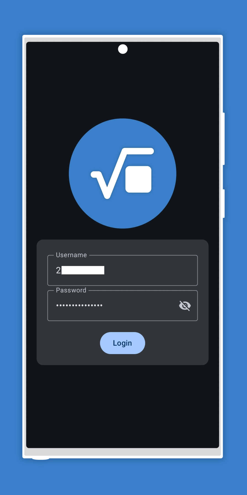
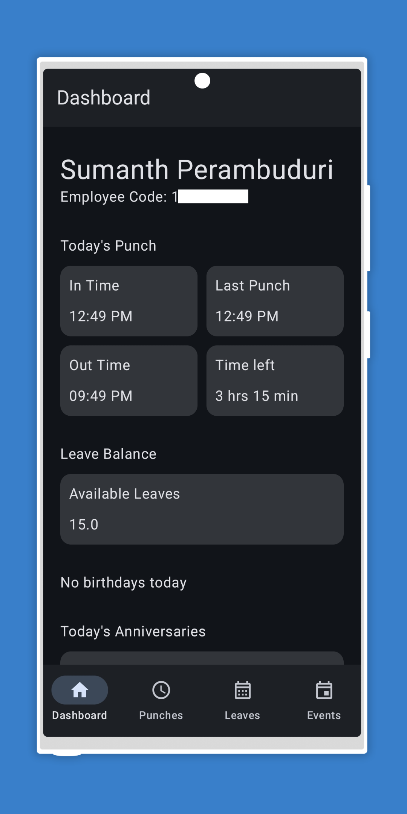
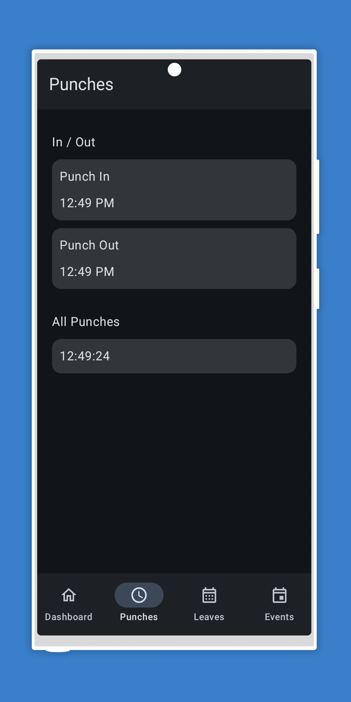
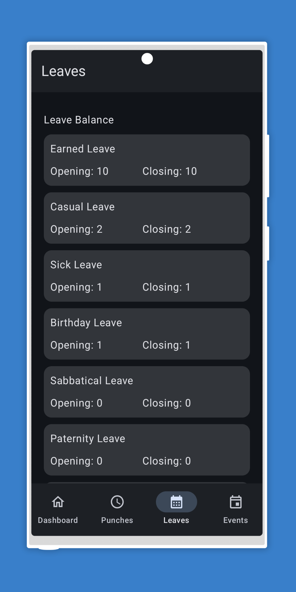
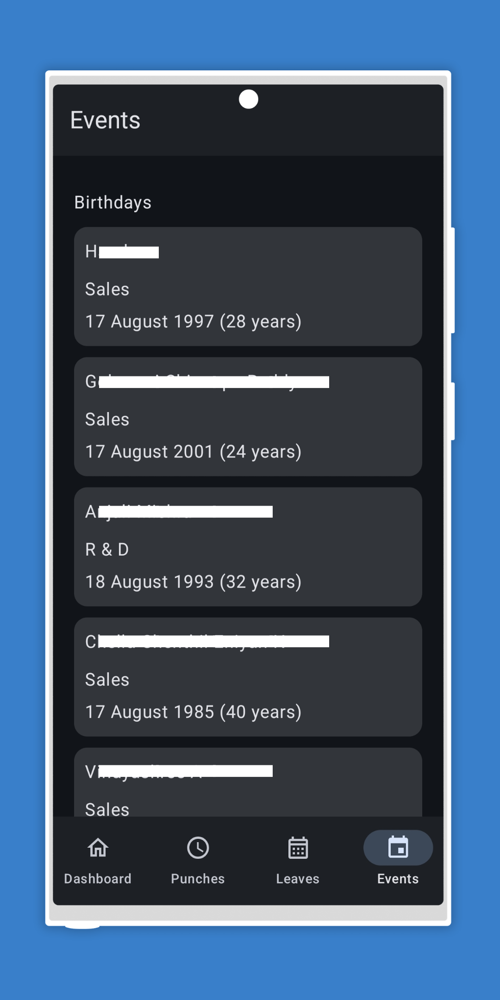

# PaySquareRoot

PaySquareRoot is an experimental Android companion app for viewing employee information available through the PaySquare portal. It provides a compact, native mobile interface for commonly checked payroll and attendance information.

> **Educational project:** This app was built for educational purposes. It makes requests to PaySquare services, as the PaySquare web portal does, to retrieve the same employee information. It is an independent project and is not an official PaySquare app.

## Why build this app?

I wanted a more convenient way to check work information on a phone. The web portal can feel slow, requires using a mobile browser because there is no mobile app, and loads data and files that are not needed for a quick check. Its mobile UI also leaves room for improvement. A native app offers a simpler, more focused experience.

Widgets were another motivation: a web portal cannot provide Android home-screen widgets. **This project does not currently include widgets**; that is a reason for building a native app, not a feature available today.

## Features

- Sign in with your PaySquare portal account.
- **Dashboard:** employee name and code, today's punch information, estimated out time and time remaining, total leave balance, today's birthdays and anniversaries, and holidays.
- **Punches:** first and last punch times and the list of punches.
- **Leaves:** leave types with opening and closing balances.
- **Events:** birthday and work-anniversary information.
- Native Android interface built with Jetpack Compose.

The app retrieves information from PaySquare services after login. Available information and behavior may depend on your account and on changes to the portal.

## Download

<a href="public/paysquareroot-1.0-beta.apk"></a>

The APK is also available at [`public/paysquareroot-1.0-beta.apk`](public/paysquareroot-1.0-beta.apk). To install it, download the APK to your Android device, allow installation from the source you used if prompted, and open the downloaded file.

## Screenshots

<table>
  <tr>
    <td></td>
    <td></td>
    <td></td>
  </tr>
  <tr>
    <td></td>
    <td></td>
    <td></td>
  </tr>
</table>

## Privacy and account information

- Login details are sent to PaySquare services to authenticate and retrieve portal information.
- The current app saves the username and password in local Android DataStore preferences so they can be filled in on a later launch. **These preferences are not encrypted by the app.** Use this beta only on a device you trust, and do not use it if you are uncomfortable with this storage behavior.
- The app displays personal and workplace information returned for the signed-in account. Keep your device secure and do not share screenshots containing private information.

## Build from source

### Requirements

- Android Studio with Android SDK 36
- JDK 11 or a compatible JDK supported by the installed Android Gradle Plugin
- Android device or emulator running Android 7.0 (API 24) or later

### Build

On Windows, run from the project root:

```powershell
.\gradlew.bat :app:assembleDebug
```

The debug APK is written to `app/build/outputs/apk/debug/app-debug.apk`.

## Technology

- Kotlin
- Jetpack Compose and Material 3
- AndroidX Navigation Compose and DataStore Preferences
- OkHttp for network requests
- Jsoup for parsing the portal login page

## Disclaimer

PaySquareRoot is an educational, independent project and is not an official PaySquare product. PaySquare and its portal remain the property of their respective owners. Use the app only with an account you are authorized to access, and follow your organization's policies and the service's terms. This beta is provided as-is; portal changes may affect its operation.
